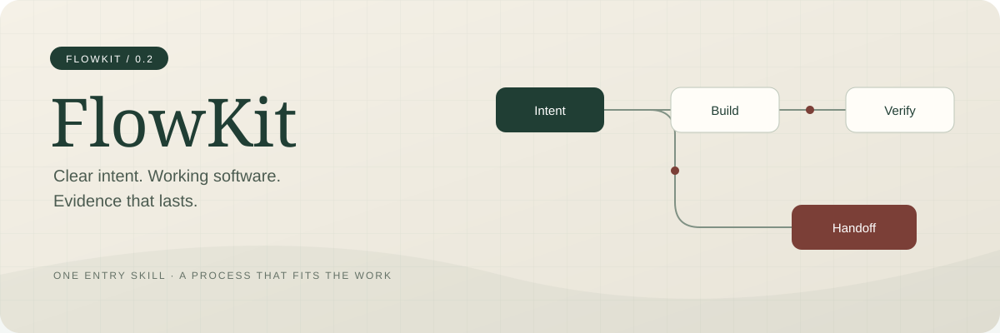
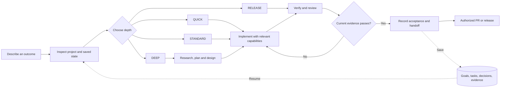

<p align="center"></p>

<p align="center"><strong>A portable engineering coordinator for AI coding agents.</strong><br>One entry skill. Proportionate process. Durable project state.</p>

<p align="center"><a href="docs/user/installation.md">Install</a> · <a href="docs/user/workflow.md">Workflow</a> · <a href="docs/user/compatibility.md">Compatibility</a> · <a href="docs/user/maintenance.md">Maintain</a> · <a href="docs/user/roadmap.md">Roadmap</a></p>

# From an outcome to a verifiable change

FlowKit helps your coding agent inspect a project, choose the right depth of work, implement a change, and leave useful evidence for the next session. Small changes stay small. Uncertain or sensitive changes receive more planning and review.

**FlowKit 0.3.0-preview.1 is a skill and a dependency-free Node.js CLI.** The skill guides judgment; the CLI stores goals, tasks and decisions, runs configured checks, and rejects missing, failed or stale verification evidence. It runs inside your existing agent, under that agent's permissions.

## Start in a few minutes

Source checkout: `git clone https://github.com/HemantKumar822/flowkit.git`, then `cd flowkit`. For an archive, extract it into an empty folder instead.

You need Node.js 22 or later, Git, and an agent that can read skills and run local commands. Obtain the source or the versioned release archive, review it, then open a terminal in its root folder:

```sh
node bin/flowkit.mjs install --host codex --scope user
```

For Claude Code use `--host claude`; for Cursor use `--host cursor`. These adapters install to host-specific skill folders. **Codex workflows have been exercised; Claude Code and Cursor runtime behavior remains unverified.** See the [support matrix](docs/user/compatibility.md).

Open a project in Codex, start a new chat if needed, and say:

```text
$flowkit inspect this project and help me implement CSV export.
Use the existing stack, define acceptance criteria, and verify the result.
```

In other hosts, select the FlowKit skill using the host's skill picker or invocation syntax. Installation does not guarantee automatic activation. See [installation and troubleshooting](docs/user/installation.md).

## The flow



| Mode | Use it for | Typical work |
| --- | --- | --- |
| QUICK | Narrow, understood, low-risk edits | Inspect → change → verify |
| STANDARD | Bounded features and bugs | Acceptance → implementation → tests → review |
| DEEP | Unclear ideas, migrations, trust boundaries | Research → requirements → architecture/design → delivery |
| RELEASE | Readiness and handoff | Checks → user journeys → risk review → release preparation |

The agent makes the final choice using context, risk and uncertainty. The CLI route suggestion is an English keyword heuristic. [Read the complete workflow](docs/user/workflow.md).

## One skill, several capabilities

Invoke **FlowKit** as the front door. Its references supply focused procedures without loading every workflow into each request. The bundled baseline works without installing another framework.

Optional capabilities improve specific work:

- **Superpowers:** existing planning, debugging, testing and review skills.
- **Design skills and browser tools:** interface design and rendered user journeys.
- **GitHub CLI or a connected GitHub tool:** issues, branches, draft PRs and CI evidence.
- **Native agent tools:** scoped delegation and isolated worktrees when available and authorized.

FlowKit bundles a small, attributed set of adapted product and review procedures; it does not bundle or automatically install those projects' executable frameworks. Missing optional tools must produce an honest limitation or an appropriate fallback. See [third-party credits and exact sources](THIRD_PARTY_NOTICES.md).

The next product phases cover artifact traceability, state migrations, team conflict recovery and actual host conformance. Those are plans, not shipped capabilities; see the [product direction](docs/user/roadmap.md).

## Why use it?

- Resume work from repository files instead of reconstructing a long chat.
- Keep acceptance criteria, dependencies, blockers and decisions visible.
- Use current check results: later source or acceptance changes invalidate earlier evidence.
- Adapt the process to the work instead of producing a backlog for every typo.
- Keep remote writes, installation updates and deployment explicit.

These are mechanisms with practical benefits, not measured productivity promises. FlowKit does not claim to outperform BMAD, gstack or Superpowers. It offers a smaller coordination layer that can work with your existing practices.

## What it does not prove

A passing test does not establish every acceptance criterion. The agent still needs to review behavior. Instructions are not a security sandbox. Fingerprints do not cover external services or deliberately excluded source paths. Host tools, permissions and model decisions vary. FlowKit reports engineering readiness; it does not authorize deployment.

The core and installation lifecycle have automated checks; the Codex workflow has real application and GitHub exercises. This does not certify all editors, projects or production environments. See [compatibility](docs/user/compatibility.md) and the [maintained roadmap](docs/user/roadmap.md).

## Update and remove

Review a new version before updating, then run from that version's folder:

```sh
node bin/flowkit.mjs install --host codex --scope user --update
node bin/flowkit.mjs uninstall --host codex --scope user
```

Owned previous installations move to a recoverable backup. Modified, foreign or linked installations are refused. Use the same host and scope you installed with. [Backup, rollback and project-state guidance](docs/user/maintenance.md).

## Built to maintain

The release package contains the runtime, user documentation, license and checksums rather than personal research files. The source repository includes tests and engineering evidence. Publication to npm or a marketplace is a separate maintainer action; the npm package remains private.

FlowKit is released under the [MIT license](LICENSE). See [security](SECURITY.md), [third-party notices](THIRD_PARTY_NOTICES.md) and [contribution guidance](CONTRIBUTING.md).
